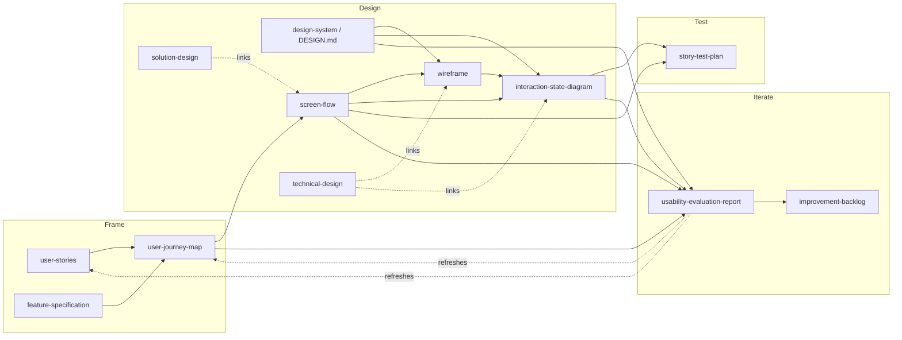

# Proposal: Five UX Artifact Types for HELIX

**Status**: draft for review | **Target repo**: HELIX methodology
(github.com/DocumentDrivenDX/helix), `workflows/` | **Proposed by**: ux-builder
maintainers | **Date**: 2026-10-21

## Purpose

HELIX has no artifact type for a user journey, a screen flow, a wireframe, a
UI state model or a usability evaluation. Teams put this material in solution
or technical designs, where it is hard to find, hard to check and impossible
to generate. This proposal adds five focused artifact types, each small enough
to generate from structured data and to check mechanically, and each linked by
ID from the existing artifacts that need it.

ux-builder (a UI SDK whose blueprint declares screens, actions, journeys and
states, with an audit and a UX assessment) will fill these artifacts in
automatically. The types do not depend on ux-builder; a team can author them
by hand.

## The Five Types

| Type | Activity | ID | Output location | One instance per |
|---|---|---|---|---|
| [`user-journey-map`](activities/01-frame/artifacts/user-journey-map/) | 01-frame | `UJM-NNN` | `docs/helix/01-frame/journey-maps/` | actor + scenario |
| [`screen-flow`](activities/02-design/artifacts/screen-flow/) | 02-design | `SF-NNN` (= FEAT number) | `docs/helix/02-design/screen-flows/` | feature |
| [`wireframe`](activities/02-design/artifacts/wireframe/) | 02-design | `WF-NNN` | `docs/helix/02-design/wireframes/` | screen or modal (all size classes) |
| [`interaction-state-diagram`](activities/02-design/artifacts/interaction-state-diagram/) | 02-design | `ISD-NNN` (= WF number for the same screen) | `docs/helix/02-design/state-diagrams/` | screen or reusable component |
| [`usability-evaluation-report`](activities/06-iterate/artifacts/usability-evaluation-report/) | 06-iterate | `UER-NNN` | `docs/helix/06-iterate/usability-evaluations/` | evaluation run |

Each folder holds `meta.yml`, `template.md`, `prompt.md` and `example.md` in
the shape of the existing HELIX types (`solution-design`, `design-system`,
`user-stories`, `improvement-backlog`). The examples describe one small
invoice-review web app with an assistant and cross-reference each other.
[`docs/resources/`](docs/resources/) holds the resource summaries the
`meta.yml` `references` entries point to, in HELIX's resource format.

## Activity Placement

### `user-journey-map` → 01-frame (not 00-discover)

- Its distinguishing job is to trace phases to `US-<n>-AC<m>`. Stories and
  ACs are Frame artifacts; a map in Discover would point forward to artifacts
  that do not exist yet.
- It informs Design directly (screen flow, solution design) the way
  `user-stories` does.
- ux-builder generates it from journeys and stories, which exist only once
  the product is framed.
- A current-state map made during discovery is still supported: `map_kind:
  current-state`, phases marked `uncovered`. If reviewers want a Discover home
  for current-state maps, the same type can be listed in both activities (see
  open questions).

### `screen-flow`, `wireframe`, `interaction-state-diagram` → 02-design

They are design decisions about the interface, at feature level (screen flow)
and at screen or component level (wireframe, state diagram), sitting beside
`design-system` (DESIGN.md), which they apply.

### `usability-evaluation-report` → 06-iterate (not 03-test)

- 03-test artifacts state verification **intent before build** (test plan,
  story test plan, test suites). A usability report records **what an
  evaluation of a built product or prototype showed**; it is evidence, like
  `metrics-dashboard`.
- Its output feeds `improvement-backlog`, `iteration-plan` and refreshes of
  Frame artifacts; that is the 06-iterate loop.
- ux-builder's assessment runs against a running app on local or staging,
  after build.
- A formative evaluation of a prototype during Design uses the same type; the
  type's home does not restrict when it is used (see open questions).

## Relationship to the Retired `ux-design`

HELIX's 02-design README retires `ux-design` and directs flow rationale,
wireframes and interaction trade-offs into the solution or technical design.
This proposal keeps that decision's intent and changes where the content
lives:

- **Rationale stays in the solution design.** Why this flow, which
  alternatives were rejected, which component owns what: unchanged.
- **The artifacts themselves move out.** The flow, the layouts and the states
  become three narrow, checkable documents the solution design links by ID
  (`SF-004`, `WF-011`, `ISD-011`) instead of restating. This is the same
  move HELIX already makes for interfaces: the solution design names the
  surface and links the Contract.
- **No monolith.** No type holds more than one concern: journey (Frame),
  flow, layout, states (Design), evaluation (Iterate). Each is optional
  (`artifact.optional: true`) and used only where the UI warrants it.
- **Proof of concept still applies** when the risk is whether an interactive
  workflow works end to end.

Proposed wording for the 02-design README note:

> `ux-design` remains retired as a standalone HELIX artifact. Put flow
> rationale and interaction trade-offs in the governing solution design or
> technical design. When the interface needs them, record the flow in a
> `screen-flow` (SF), layouts in `wireframe` (WF) and UI states in
> `interaction-state-diagram` (ISD), and link them by ID from the design.

## How the Types Relate

| New type | Informed by | Informs |
|---|---|---|
| user-journey-map | prd, feature-specification, user-stories, research-plan, usability-evaluation-report | screen-flow, solution-design, story-test-plan, usability-evaluation-report, improvement-backlog |
| screen-flow | feature-specification, user-stories, user-journey-map, design-system | solution-design, technical-design, wireframe, interaction-state-diagram, story-test-plan, usability-evaluation-report |
| wireframe | screen-flow, user-stories, design-system | technical-design, interaction-state-diagram, story-test-plan, usability-evaluation-report |
| interaction-state-diagram | screen-flow, wireframe, user-stories, design-system | technical-design, story-test-plan, usability-evaluation-report |
| usability-evaluation-report | user-journey-map, screen-flow, wireframe, interaction-state-diagram, design-system, user-stories, story-test-plan | improvement-backlog, user-journey-map, user-stories, design-system, iteration-plan |

Boundaries with existing types:

- **design-system (DESIGN.md)** sets app-wide conventions (how any loading or
  error state looks); **ISD** says which states one screen has and what each
  does. Wireframes reference tokens, never define them.
- **user-stories** own testable behavior; the journey map and screen flow
  trace to AC IDs and never restate criteria.
- **story-test-plan** owns AC-to-test mapping; ISD states and SF alternate
  paths are what its UX Coverage rows (data-states, async-actions,
  keyboard-overlays) point at.
- **improvement-backlog** ranks work across all learnings; the UER records
  one run's findings and routes them there.

## What ux-builder Fills In

| Type | ux-builder source | What is generated | What still needs a person |
|---|---|---|---|
| user-journey-map | Blueprint `journeys[]` (story, criteria, steps, alternates) + the HELIX stories they name | Actor, scenario, phases grouped from steps, AC links, coverage gaps | Thoughts, emotions, insights, opportunities and their evidence |
| screen-flow | Blueprint `screens[]`, `modals`, `actions[]` (`to`, `primary`, `destructive`), `destinations`, `journeys[]` | Nodes, Mermaid flowchart, transitions table, alternate paths, journey traceability; `blueprint check` flow and journey findings as dead ends | Hotspot wording, guards the blueprint cannot express, rationale (in SD) |
| wireframe | Blueprint screen (pattern, actions, modals, states) + `supports.sizeClasses` + rendered pattern per size class | One layout per size class, callouts per action with links, states list, accessibility notes from the accessibility tree | Content decisions above mid fidelity |
| interaction-state-diagram | Blueprint `screens[].states`, `state:` action targets, journey steps with `state`/`expect`, pattern state content | State inventory, statechart, matrix with announcements | Guards and timing; states marked inferred |
| usability-evaluation-report | `ux-builder-audit assess` run: plan, coverage matrix, merged findings (`F-` IDs) with evidence, proposals, `compare` against an earlier run, video timestamps | Method, tasks, findings by journey, state coverage, conformance, routing | Expert judgment on severity factors and modality fit |

## Conventions and Deviations

- **Frontmatter.** Templates carry `ddx.id`, `ddx.type`, `ddx.authoring.home`
  and `ddx.depends_on` (the links). `ddx.status` is omitted: HELIX's
  `artifact-schema.md` marks it legacy and says new templates omit it.
- **IDs.** `SF` shares the FEAT number; `ISD` shares the WF number for the
  same screen; findings keep stable `F-` IDs across UERs.
- **Voice.** All five use `artifact-signal`.
- **Optional.** All five set `artifact.optional: true`.
- **Out of scope for this proposal**: changes to `graph.yml`, gates,
  `workflow.yml` and the solution-design and story-test-plan templates. If
  the types are accepted, follow-ups are: add them to `graph.yml`; add a
  "UX Artifacts" link row to the solution-design and technical-design
  templates; let the STP UX Coverage table cite ISD states; update the
  02-design README note above.

## Open Questions for Reviewers

1. **Journey map home.** Frame only, or also listed under 00-discover for
   current-state maps? One type in two activities, or `map_kind` alone?
2. **Report home.** 06-iterate as proposed, or 03-test? Should a formative
   prototype evaluation during Design be a UER or a proof-of-concept finding?
3. **Granularity of SF.** One screen flow per feature (proposed) or per
   journey? Large features may need a split rule.
4. **Wireframe as text.** Is an ASCII box drawing acceptable as the layout at
   low and mid fidelity, or must every wireframe carry an image asset?
5. **Severity vs priority.** ux-builder's assessment ranks findings P0–P3
   (`assess gate --fail-on P1`). Adopt NN/g 0–4 as the HELIX scale and map
   4→P0, 3→P1, 2→P2, 1→P3, or keep both fields?
6. **Rule citation.** Findings must cite the rule's statement. Quoting WCAG or
   heuristics in full raises copyright and length concerns; is "paraphrased +
   source link" the norm, with full quotes only for project-owned rules?
7. **State inventory.** Are offline, slow, permission-denied and success the
   right additions to the UI Stack, and should "slow" have a project-wide
   threshold in DESIGN.md rather than per ISD?
8. **Modality fit.** Which guideline sets should HELIX name per modality
   (for example human-AI interaction guidance for assistants)? Should that
   live in a concern (such as `ux-interaction-patterns`) instead of the report?
9. **ISO/IEC 25062 edition.** The ISO catalogue page could not be fetched
   for this draft; confirm the current edition's scope (evaluation approaches
   beyond user testing) before the resource summary is published.
10. **Pattern checks.** Are the proposed regex checks (`Fidelity**: …`,
    `Severity**: [0-4]`, `stateDiagram-v2`) acceptable to HELIX's validators,
    or should they move to `automated_checks`?

## Sources

Paraphrased; no text copied. Summaries in [`docs/resources/`](docs/resources/).

- NN/g, Journey Mapping 101 — https://www.nngroup.com/articles/journey-mapping-101/
- NN/g, Severity Ratings for Usability Problems — https://www.nngroup.com/articles/how-to-rate-the-severity-of-usability-problems/
- NN/g, Wireflows — https://www.nngroup.com/articles/wireflows/
- Scott Hurff, Why your user interface is awkward: you're ignoring the UI Stack — https://www.scotthurff.com/posts/why-your-user-interface-is-awkward-youre-ignoring-the-ui-stack/ (verified 2026-10-21); summary: https://smart-interface-design-patterns.com/articles/how-to-fix-a-bad-user-interface/
- statecharts.dev, Benefit: all states are explored — https://statecharts.dev/benefit-all-states-explored.html
- ISO/IEC 25062, Common Industry Format for usability reports — https://www.iso.org/standard/84255.html
- NIST, NISTIR 7742, Customized Common Industry Format Template for EHR Usability Testing — https://nvlpubs.nist.gov/nistpubs/Legacy/IR/nistir7742.pdf
- Adobe XD Ideas, Annotated Wireframes for Product Design — https://xd.adobe.com/ideas/process/wireframing/annotated-wireframes-for-product-design
- Uxcel, Wireframes Annotations & Documentation — https://uxcel.com/lessons/wireframes-annotations--documentation-187; Wireframing Best Practices — https://uxcel.com/lessons/wireframing-best-practices-816; Wireframe Fidelity — https://uxcel.com/lessons/wireframe-fidelity-850
