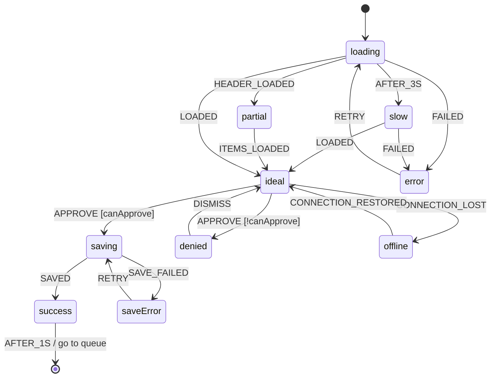

---
ddx:
  id: example.interaction-state-diagram.invoice
  type: interaction-state-diagram
  authoring:
    home: repo
  depends_on:
    - example.screen-flow.invoice-review
    - example.wireframe.invoice
---

# ISD-011: Invoice States

**Subject**: screen `invoice` in [[SF-004]] | **Wireframe**: [[WF-011]] | **Stories**: [[US-021]], [[US-022]], [[US-023]]

## Scope

- **Covers**: The invoice screen and its decision action bar.
- **Uses**: [[ISD-020]] for the assistant panel's states (streaming, answered, unavailable).
- **Out of scope**: Reject-reason dialog validation (ISD-021).

## State Inventory

| State | Applies | Reason if not |
|---|---|---|
| ideal | yes | — |
| empty | no | A single record cannot be empty; a missing invoice is `error` (not found). |
| loading | yes | — |
| partial | yes | Line items load after the header on large invoices. |
| error | yes | Load failure or not found. |
| offline | yes | — |
| slow | yes | Loading longer than 3 s. |
| permission-denied | yes | Reviewers without approval rights. |
| success / confirmation | yes | After approval, before returning to the queue. |
| saving, save-error | yes | Approve is async. |

## Statechart

## State Matrix

| State | Entered when | User sees | Available actions | Announcement | Exit |
|---|---|---|---|---|---|
| loading | Screen opens | Skeleton of summary and line items | Back | none — focus on h1 "Loading invoice" | LOADED, HEADER_LOADED, FAILED, AFTER_3S |
| slow | Loading > 3 s | Skeleton + "Still loading…" | Back | "Still loading the invoice" (polite) | LOADED, FAILED |
| partial | Header loaded first | Summary; line items skeleton | Why flagged?, Back | none | ITEMS_LOADED |
| ideal | Data loaded | Full invoice, action bar | Why flagged?, Reject, Approve, Back | none | APPROVE, CONNECTION_LOST |
| error | Load failed or not found | "We couldn't load INV-2291" + reason | Try again, Back | "Couldn't load the invoice" (assertive) | RETRY |
| offline | Connection lost | Banner "You're offline — decisions are paused"; Approve and Reject disabled | Back | "You're offline" (polite) | CONNECTION_RESTORED |
| denied | Approve without rights | Inline "You can't approve invoices. Ask an AP lead." | Reject, Back | "You can't approve invoices" (assertive) | DISMISS |
| saving | Approve pressed | Approve busy; second click blocked | none — wait (< 2 s typical) | "Approving" (polite) | SAVED, SAVE_FAILED |
| saveError | Save failed | Inline "Approval didn't save"; decision kept | Try again, Back | "Approval didn't save" (assertive) | RETRY |
| success | Saved | Check mark "Approved" | none — returns to queue in 1 s | "Invoice approved" (polite) | AFTER_1S |

## Events and Transitions

| From | Event | Guard | To | Effect |
|---|---|---|---|---|
| loading | AFTER_3S | — | slow | Show "Still loading…" |
| loading, slow | LOADED | — | ideal | Focus stays on h1 |
| loading | HEADER_LOADED | — | partial | — |
| partial | ITEMS_LOADED | — | ideal | — |
| loading, slow | FAILED | — | error | Focus moves to error message |
| error | RETRY | — | loading | Re-request |
| ideal | APPROVE | canApprove | saving | Send approval |
| ideal | APPROVE | !canApprove | denied | No request sent |
| denied | DISMISS | — | ideal | Focus returns to Approve |
| saving | SAVED | — | success | — |
| saving | SAVE_FAILED | — | saveError | Decision and note kept |
| saveError | RETRY | — | saving | Resend same decision |
| success | AFTER_1S | — | final | Navigate to queue; queue announces remaining count |
| ideal | CONNECTION_LOST | — | offline | Disable decisions |
| offline | CONNECTION_RESTORED | — | ideal | Re-enable decisions |

## Timing

- **Slow threshold**: 3 s.
- **Feedback durations**: success shown 1 s.

## Open Questions

- Should Approve be hidden rather than disabled for reviewers without rights? DESIGN.md says disabled with reason; confirm with AP lead.
