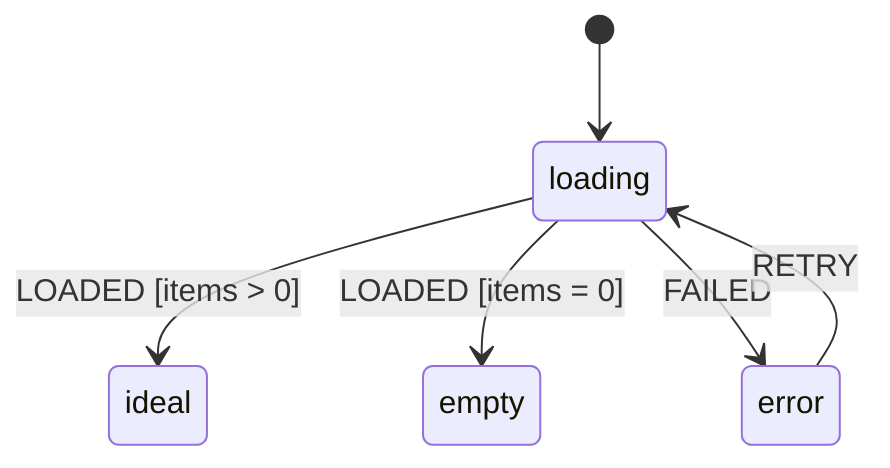

---
ddx:
  id: ISD-XXX
  type: interaction-state-diagram
  authoring:
    home: repo
  depends_on:
    - SF-XXX
    - WF-XXX
---

# ISD-XXX: [Screen or Component] States

**Subject**: [screen node `id` in [[SF-XXX]] | component name] | **Wireframe**: [[WF-XXX]] or none | **Stories**: [[US-XXX]]

## Scope

- **Covers**: [The screen or component and the regions with their own states]
- **Uses**: [Component ISDs this one references instead of repeating]
- **Out of scope**: [States owned by another ISD]

## State Inventory

<!-- Every standard state: applies, or not-applicable with a concrete reason. -->

| State | Applies | Reason if not |
|---|---|---|
| ideal | yes | — |
| empty | [yes / no] | [e.g. single record: not-found is the error state] |
| loading | | |
| partial | | |
| error | | |
| offline | | |
| slow | | |
| permission-denied | | |
| success / confirmation | | |
| [other: saving, editing, streaming…] | | |

## Statechart

<!-- Harel-style. Use composite states for regions with their own states and
`--` for parallel regions. Label transitions `EVENT [guard]`. -->

## State Matrix

<!-- Announcement: the text a screen reader hears and its politeness
(polite / assertive), or "focus moves to …" when focus carries the change. -->

| State | Entered when | User sees | Available actions | Announcement | Exit |
|---|---|---|---|---|---|
| [state] | [event or condition] | [What is on screen] | [Actions, or "none — reason"] | ["Text" (polite)] | [Events that leave] |

## Events and Transitions

| From | Event | Guard | To | Effect |
|---|---|---|---|---|
| [state] | [EVENT] | [condition or —] | [state] | [What the system does: request, focus move, data kept] |

## Timing

- **Slow threshold**: [When loading becomes slow, e.g. after 3 s]
- **Feedback durations**: [Toast or undo windows]

## Open Questions

- [Unresolved state or event]
