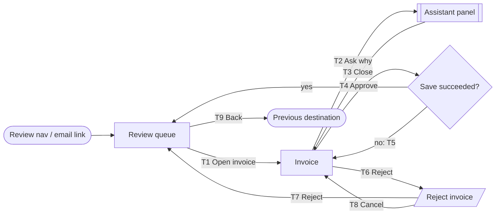

---
ddx:
  id: example.screen-flow.invoice-review
  type: screen-flow
  authoring:
    home: repo
  depends_on:
    - example.feature-specification.invoice-review
    - example.user-stories.invoice-review
    - example.user-journey-map.invoice-review
---

# SF-004: Invoice Review Screen Flow

**Feature**: [[FEAT-004]] | **Solution design**: [[SD-004]] | **Journey maps**: [[UJM-001]]

## Scope

- **Covers**: Review queue, invoice detail, assistant panel, reject-reason dialog.
- **Entry points**: "Review" nav destination; deep link from the daily email.
- **Exits**: Back to the previous destination; supplier email (system-sent).
- **Fidelity**: boxes — the review checks paths and feedback, not layout.
- **Size classes**: compact, expanded. On compact the assistant panel replaces the invoice instead of sitting beside it.
- **Out of scope**: Supplier management (SF-006).

## Nodes

| ID | Kind | Title | Purpose | Stories |
|---|---|---|---|---|
| queue | screen | Review queue | Pick the next flagged invoice | US-021 |
| invoice | screen | Invoice | Decide on one invoice | US-021, US-023 |
| assistant | panel | Assistant | Explain the flag | US-022 |
| reject-reason | modal | Reject invoice | Record the reason | US-023 |
| saved | decision | Save succeeded? | — | US-021 |

## Flow Diagram

## Transitions

| ID | From | Action (hotspot) | Guard | To | Feedback | Changed region |
|---|---|---|---|---|---|---|
| T1 | queue | Open invoice — row | — | invoice | loading skeleton | full screen |
| T2 | invoice | Ask why — "Why flagged?" button | assistant available | assistant | streaming answer | side panel (expanded); full screen (compact) |
| T3 | assistant | Close — panel close button / Esc | — | invoice | focus returns to "Why flagged?" | side panel |
| T4 | invoice | Approve — primary button | not already decided | saved | button busy, double-submit blocked | action bar |
| T5 | saved | — (system) | save failed | invoice | inline error, decision kept, "Try again" | action bar |
| T6 | invoice | Reject — secondary button | — | reject-reason | dialog opens, focus on reason | modal |
| T7 | reject-reason | Reject — dialog primary | reason not empty | queue | toast "Rejected" with Undo (10 s) | full screen |
| T8 | reject-reason | Cancel — button / Esc | — | invoice | focus returns to Reject | modal |
| T9 | queue | Back — browser back | — | exit | — | full screen |

## Alternate Paths

| Path | Trigger | Transitions | Recovery |
|---|---|---|---|
| Error | Approve save fails | T4 → T5 | "Try again" re-runs T4; decision kept |
| Cancel | User abandons rejection | T6 → T8 | Back on invoice, nothing changed |
| Empty | No flagged invoices | queue empty state | "Show all invoices" link |
| Permission denied | Reviewer lacks approval rights | T4 guard fails | Approve disabled with reason; Reject still available |
| Assistant unavailable | Model service down | T2 guard fails | Button shows "Assistant unavailable"; review continues |

## Journey Traceability

| Journey | Story / ACs | Path | Notes |
|---|---|---|---|
| J-review | US-021-AC1, US-021-AC2 | T1 → T4 → queue | Main path |
| J-review / save fails | US-021-AC3 | T1 → T4 → T5 → T4 | Alternate |
| J-explain | US-022-AC1, US-022-AC3 | T1 → T2 → T3 | |
| J-reject | US-023-AC1, US-023-AC2 | T1 → T6 → T7 | Undo within toast |

## Dead Ends and Open Questions

- None. US-023-AC3 (supplier email) is system-sent and has no node.
