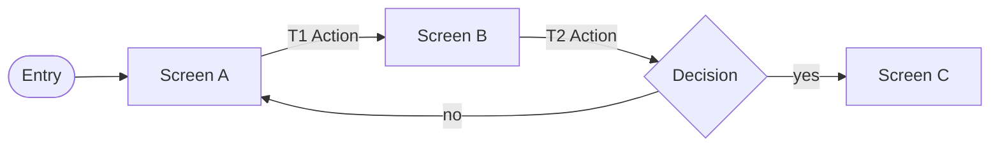

---
ddx:
  id: SF-XXX
  type: screen-flow
  authoring:
    home: repo
  depends_on:
    - FEAT-XXX
    - US-XXX
---

# SF-XXX: [Feature Name] Screen Flow

**Feature**: [[FEAT-XXX]] | **Solution design**: [[SD-XXX]] | **Journey maps**: [[UJM-XXX]] or none

## Scope

- **Covers**: [The screens and modals this feature owns]
- **Entry points**: [Where users arrive from — nav destination, deep link, notification]
- **Exits**: [Where the flow hands off — another feature, external system, sign-out]
- **Fidelity**: [boxes | thumbnails | annotated-wireframes] — [why this fidelity fits the purpose]
- **Size classes**: [compact, medium, expanded…] — [note where the flow differs by size class]
- **Out of scope**: [Adjacent flows owned elsewhere, by SF ID]

## Nodes

<!-- Kind: screen | modal | panel | toast | external | decision. One row per node. -->

| ID | Kind | Title | Purpose | Stories |
|---|---|---|---|---|
| [node-id] | screen | [Title] | [The one task this node serves] | [US-XXX] |

## Flow Diagram

<!-- Nodes and edges must match the tables. Label edges with the transition ID
and action. Use a diamond for decisions, a stadium for entry/exit. -->

## Transitions

<!-- Action (hotspot): the action name and the control that triggers it.
Guard: the condition, or "—". Feedback: what the user sees during and after.
Changed region: "full screen" or the part that changes. -->

| ID | From | Action (hotspot) | Guard | To | Feedback | Changed region |
|---|---|---|---|---|---|---|
| T1 | [node] | [action — control] | [condition or —] | [node] | [progress / success / error / undo] | [full screen or region] |

## Alternate Paths

<!-- Every action that can fail, be cancelled, return nothing, be denied or
run offline. Name the transition IDs it uses, or why it cannot occur. -->

| Path | Trigger | Transitions | Recovery |
|---|---|---|---|
| Error | [What fails] | [T-IDs] | [How the user recovers; data kept?] |
| Cancel | | | |
| Empty | | | |
| Permission denied | | | |

## Journey Traceability

| Journey | Story / ACs | Path | Notes |
|---|---|---|---|
| [Journey ID or name] | [US-XXX-AC1, …] | [T1 → T2 → …] | [Alternate of which journey, if any] |

## Dead Ends and Open Questions

- [Node with no exit, unreachable node, or unresolved branch — or "None"]
